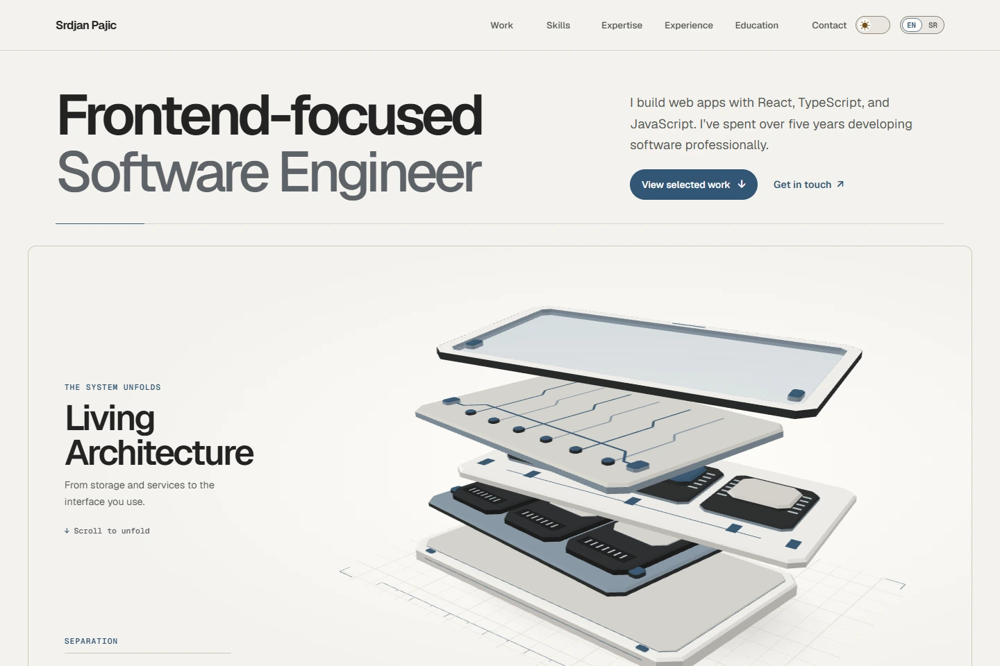
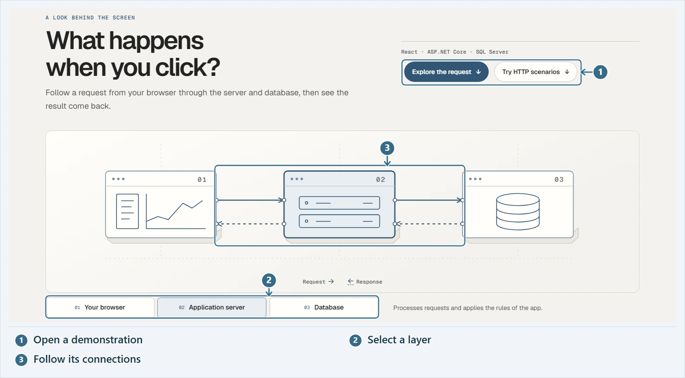
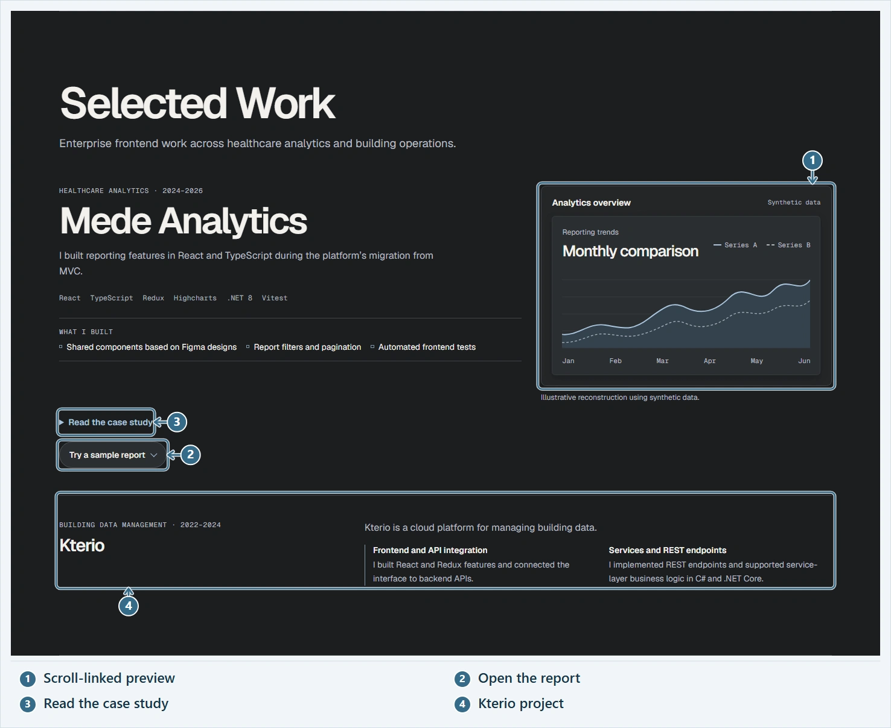
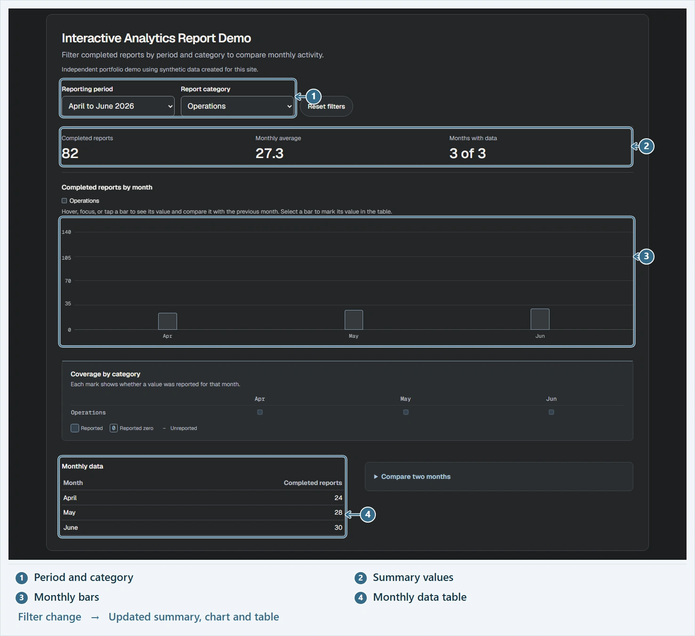
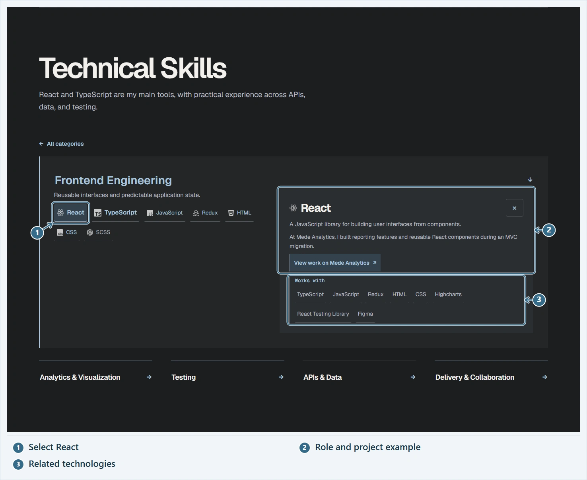
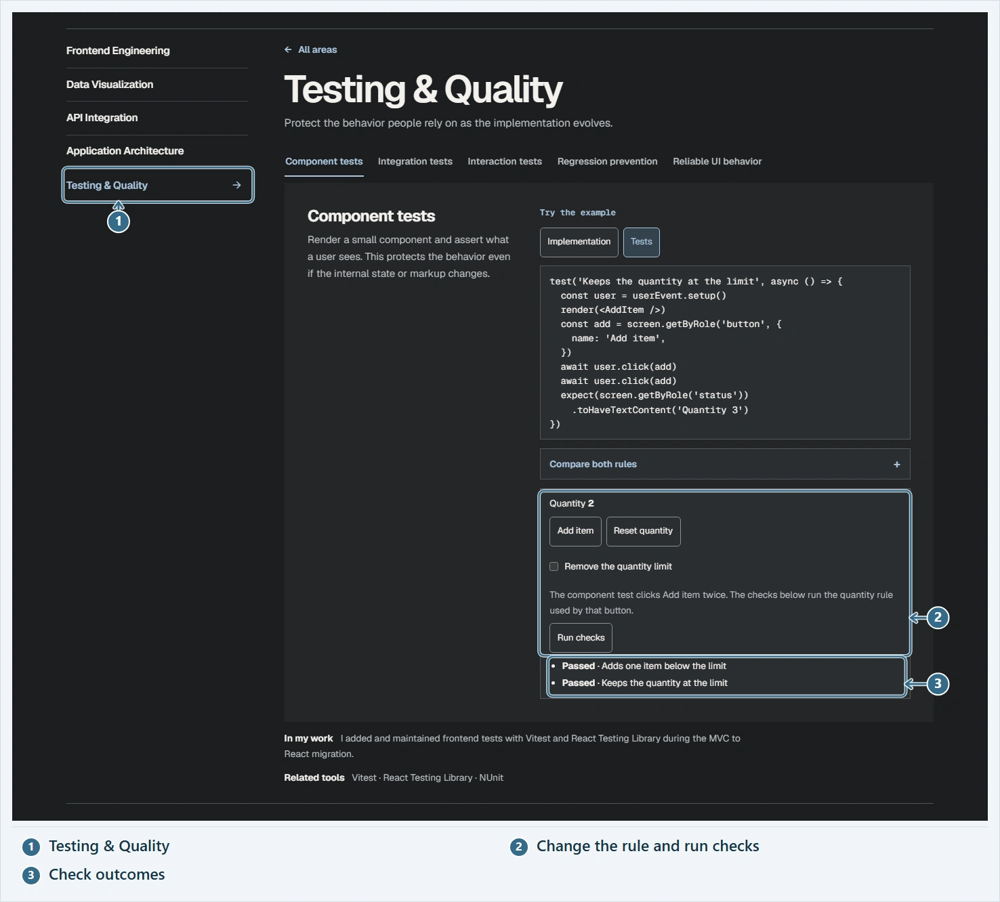
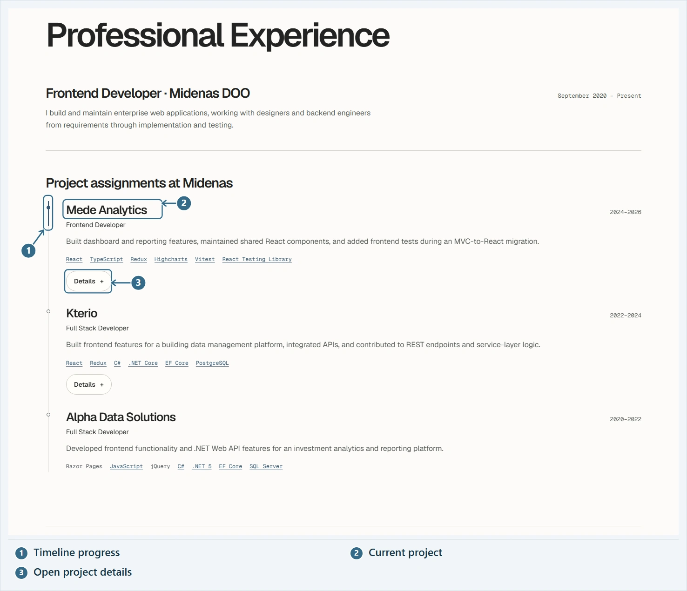
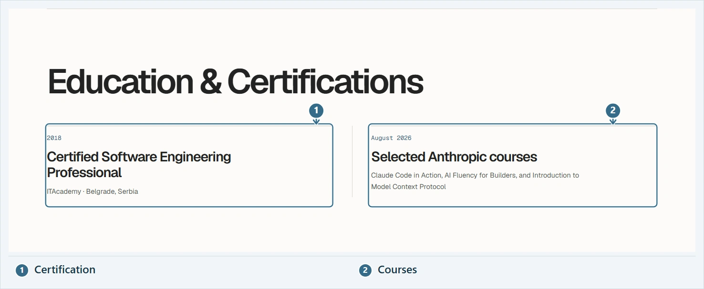
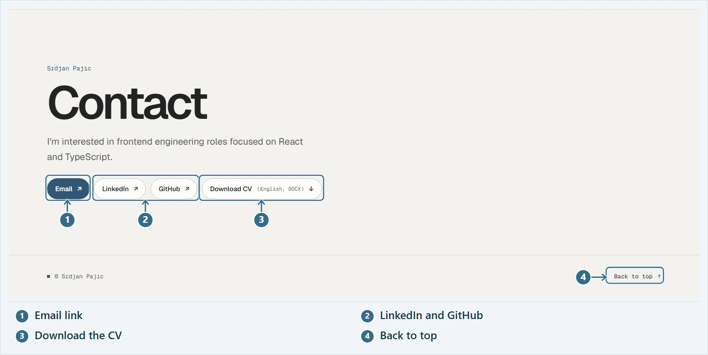

# Srdjan Pajic | Portfolio walkthrough

Explore the work and technical demonstrations of a frontend-focused software engineer.

[Open the portfolio](https://srdjan7991-sudo.github.io/portfolio/)

- [Opening screen and navigation](#opening-screen-and-navigation)
- [Behind every request](#behind-every-request)
- [Selected Work](#selected-work)
- [Analytics Report Demo](#analytics-report-demo)
- [Technical Skills](#technical-skills)
- [How I Engineer](#how-i-engineer)
- [Professional Experience](#professional-experience)
- [Education and Contact](#education-and-contact)
- [Run locally](#run-locally)

The numbered callouts tie each screenshot to the steps beneath it. Open a screenshot to read the interface at full size.

## Opening screen and navigation



1. Use the header links to jump to a section. On a phone, open **Menu** first.
2. Switch between light and dark or between **EN** and **SR**. The portfolio remembers both preferences.
3. **View selected work** takes you to the projects. **Get in touch** goes directly to Contact.
4. In **Living application architecture**, choose **Refresh queue** or **Pin first task**. Follow the request to the API and check the result in the review queue. Select **API**, **Service**, or **Data** to inspect its role and connections.

See the controls on a phone and follow a queue refresh from click to response. [Opening screen and navigation guide](docs/guide/using-the-portfolio.md)

## Behind every request



1. Choose **Explore the request** to step through a request or **Try HTTP scenarios** to try a failure or a slower response.
2. Choose **Your browser**, **Application server**, or **Database** to reveal its role in the diagram.
3. Follow the solid request line and the dashed response line. In the animated layout, the layers separate as you scroll into the section and come back together when you reverse direction.

Follow all six phases or recover from a simulated HTTP 500. [Behind every request guide](docs/guide/request-flow.md)

## Selected Work



1. Scroll toward the Mede Analytics preview. Its lines draw into view and clear as you scroll past. With reduced motion the completed preview holds still.
2. Open **Try a sample report** to work with filters and the bar chart.
3. Open **Read the case study** to see the project context, contribution, implementation, and validation.
4. Continue to **Kterio** for the building operations work and the split between the interface and services.

## Analytics Report Demo



1. Set **Reporting period** to **April to June 2026** and **Report category** to **Operations**.
2. The summary shows **82** completed reports and an average of **27.3** per month.
3. Hover over or focus a bar to see its value and the previous-month comparison when available. Select the bar by clicking, tapping, or pressing **Enter** to mark its value in the table.
4. Read the matching counts of **24**, **28**, and **30** in **Monthly data**. Use **Reset filters** to return to the starting view.

The demo uses synthetic portfolio data. See bar selection, month comparison, and the empty result on mobile. [Analytics Report Demo guide](docs/guide/analytics-report.md)

## Technical Skills



1. Open **Frontend Engineering** in Skills and select **React**.
2. Read the description and the example from Mede Analytics in the open detail.
3. Choose a technology under **Works with**, such as **TypeScript**, to open its detail. Use **All categories** to explore the other groups.

## How I Engineer



1. Open **Testing & Quality** in **How I Engineer**.
2. Under **Component tests**, choose **Tests** to see the example. Select **Run checks** with the limit enabled.
3. Both checks pass. Select **Remove the quantity limit** and run them again. The check at the limit now reports the difference between the expected and actual quantities.

Try filtering a state example, changing the sample range of a chart, simulating API responses, and inspecting module boundaries. [Engineering examples guide](docs/guide/engineering-and-experience.md#how-i-engineer)

## Professional Experience



1. Follow the filled portion of the rail as you scroll through the projects.
2. The project near the center of the viewport gets a filled dot. Scroll up to see the previous project become active again.
3. Open **Details** on Mede Analytics or Kterio for case notes. Select an underlined technology to jump to its detail in Technical Skills.

See an expanded project on mobile and how to return to it from Skills. [Professional Experience guide](docs/guide/engineering-and-experience.md#professional-experience)

## Education and Contact



1. Read the software engineering certification and its date.
2. Review the selected Anthropic courses and their date.



1. **Email** opens your configured mail app.
2. **LinkedIn** and **GitHub** open in new tabs.
3. **Download CV** saves the English CV as a DOCX file.
4. **Back to top** in the footer returns to the opening screen.

## Run locally

Install Git and Node.js 24.x with npm. Clone the repository and start Vite.

```sh
git clone https://github.com/srdjan7991-sudo/portfolio.git
cd portfolio
npm ci
npm run dev
```

Open the URL printed by Vite. The default HTTP setup uses the bundled section order, the guided walkthrough, and the simulated HTTP scenarios without a database. GitHub Pages serves the last deployed static build.

- [Project reference](docs/guide/project-reference.md) for the stack, repository structure, and npm commands.
- [Architecture](docs/architecture.md) for the React application, interaction models, and section ordering.
- [Local backend and API](docs/backend.md#local-setup) for HTTPS, SQL Server, Swagger, and the administrator controls that save the order of the six content sections.
- [Testing and deployment](docs/testing-and-deployment.md) for frontend and backend checks and the GitHub Pages release workflow.
