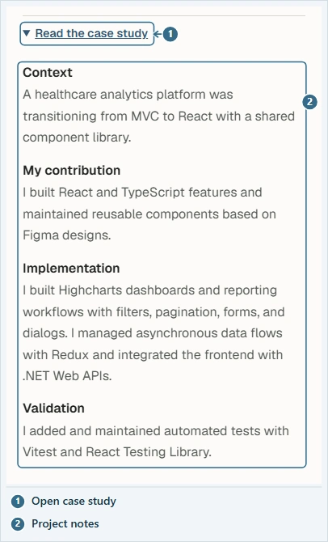
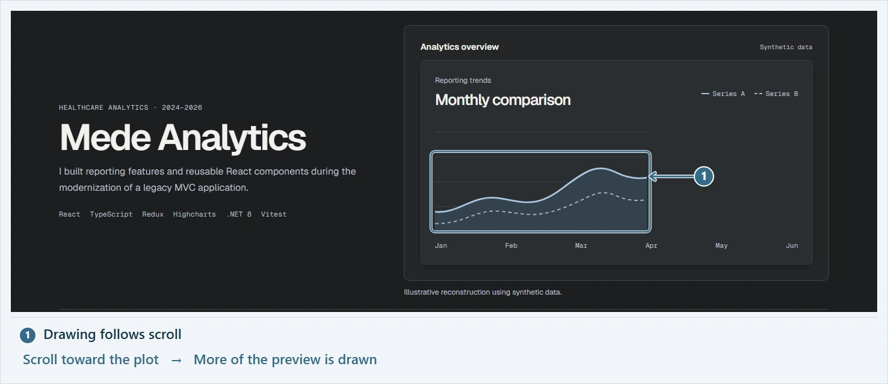
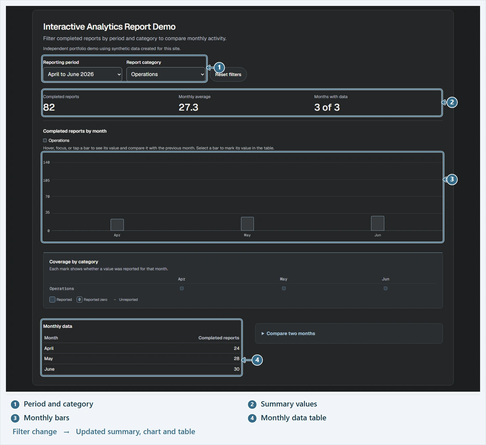
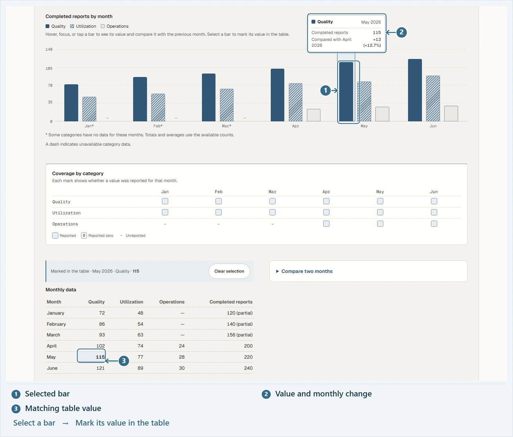
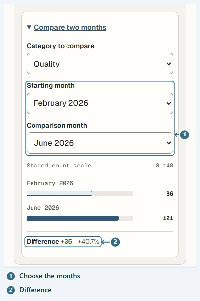
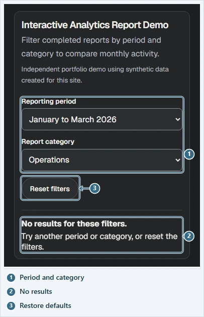

# Explore the Analytics Report Demo

[Back to the portfolio guide](../../README.md) · [Open Selected Work](https://srdjan7991-sudo.github.io/portfolio/#work)

In **Selected Work**, scroll to **Mede Analytics**. Read **What I built** and open **Read the case study** for the responsibilities, technical approach, implementation, verification, and value of the reporting work.

1. Tap **Read the case study** to expand it.
2. Read the project notes beneath the toggle. Tap the same control to close them.

The compact **Analytics overview** illustrates a reporting layout with synthetic data. With motion enabled and scroll timeline support, its lines and grid draw as the plot enters view and clear as you pass it. Scrolling back reverses the change. With reduced motion the full chart is visible.

Choose **Try a sample report** under Mede Analytics to open the separate interactive demo. It uses synthetic data created for the portfolio.

## Filter the report

1. **Start with the default view.** **January to June 2026** and **All categories** show 15 observations across Quality, Utilization, and Operations.
2. **Change the filters.** Set **Reporting period** to **April to June 2026** and **Report category** to **Operations**.
3. **Read the result.** The summary updates to **82 completed reports**, a **27.3 monthly average**, and **3 of 3 months with data**. The chart and table show the same counts of **24**, **28**, and **30** for April, May, and June.

1. **Filters** set the period and category for the report.
2. **Summary** shows the total, monthly average, and number of months with data.
3. **Chart** shows a bar for each reported observation. **Coverage by category** beneath the plot distinguishes reported values, reported zeroes, and missing observations.
4. **Monthly data** lists the exact counts for the selected months.

## Follow a bar into the table

1. Choose **Reset filters** to return to the default view. Hover over or focus the **Quality** bar for **May 2026**. The reading shows **115**, up **13** or **12.7%** from April. On narrow charts, the reading has its own space in the layout and comes into view when tapped if needed.
2. Click or tap the bar, or press **Enter** or **Space** while it has focus. The corresponding table cell is marked and the **Marked in the table** summary appears.
3. Press **Escape** to dismiss the tooltip and keep the mark. Close and reopen the report to see the same cell still marked.

1. **Bar** identifies the month and category by its position and accessible label.
2. **Tooltip** gives the exact count and any available change from the previous calendar month.
3. **Marked table value** shows which cell corresponds to the selected bar.

Choose **Clear selection** above the table or activate the same bar again to remove the mark. Changing the main filters also clears it.

## Compare two months directly

1. With the default filters, open **Compare two months** below **Monthly data**.
2. Set **Category to compare** to **Quality**, **Starting month** to **February 2026**, and **Comparison month** to **June 2026**.
3. Read the two counts on a shared scale. **86 → 121** gives a **+35** count difference and **+40.7%** relative to February. Select the same month twice to see the prompt to choose two different months.

1. **Month selectors** use the current report period.
2. **Difference** shows the comparison count minus the starting count and the percentage change from the starting count.

Choose **Operations** and compare **January 2026** with **June 2026** to see how the report explains a missing observation. January has no reported Operations value, so there is no difference to calculate.

## Recover from an empty result

1. Set **Reporting period** to **January to March 2026** and **Report category** to **Operations**.
2. The report shows **No results for these filters** because this category's observations start in April.
3. Choose **Reset filters**. The full six-month chart and monthly table return.

1. **Selected filters** reproduce the empty result.
2. **Empty result** explains that the filters can be changed or reset.
3. **Reset filters** restores **January to June 2026** and **All categories**.
