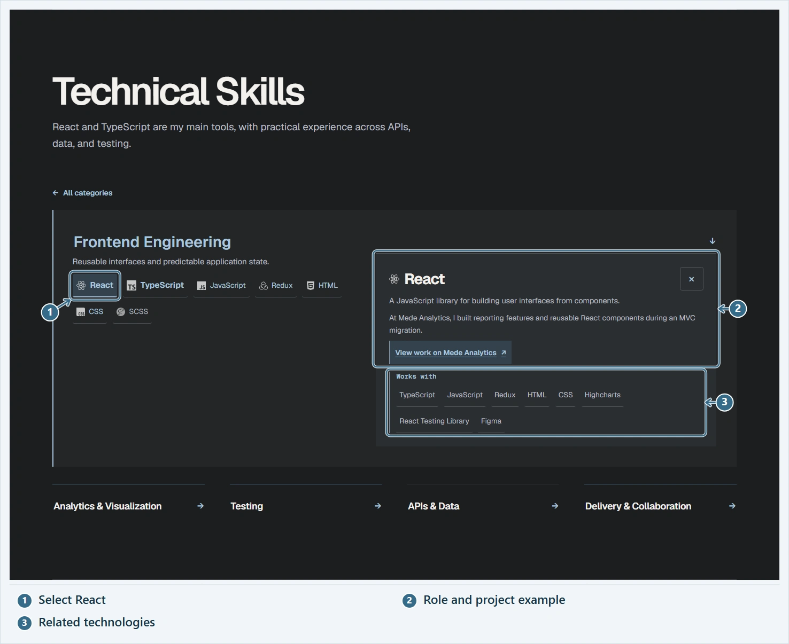
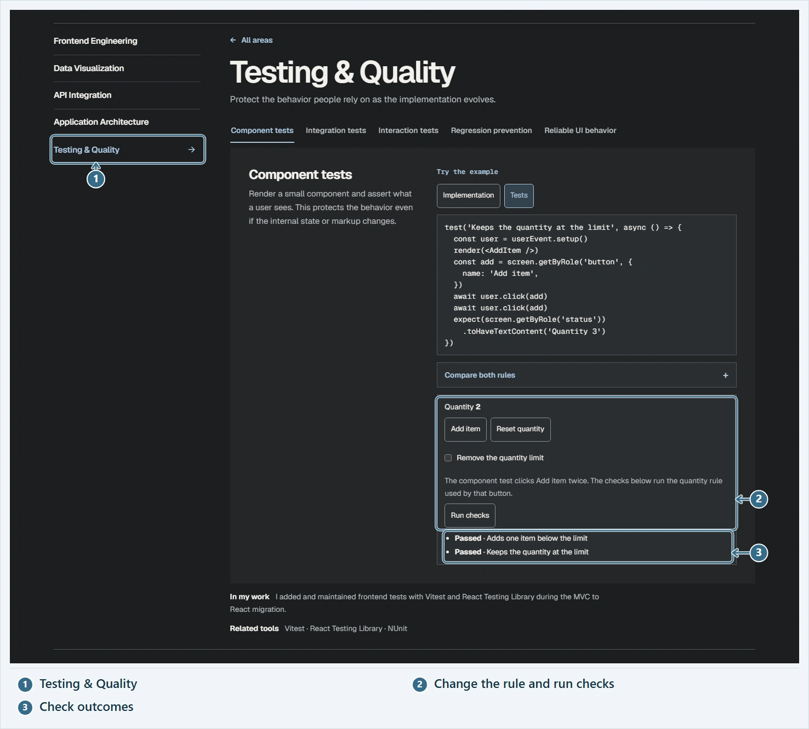
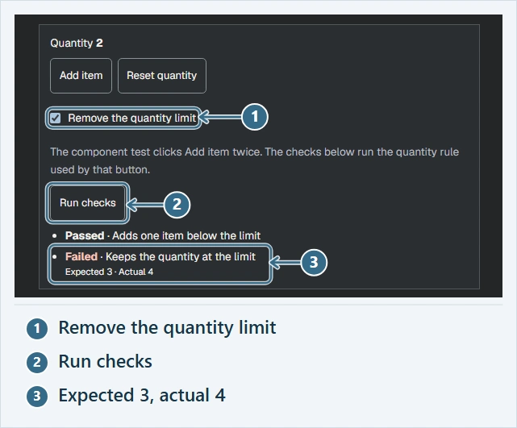
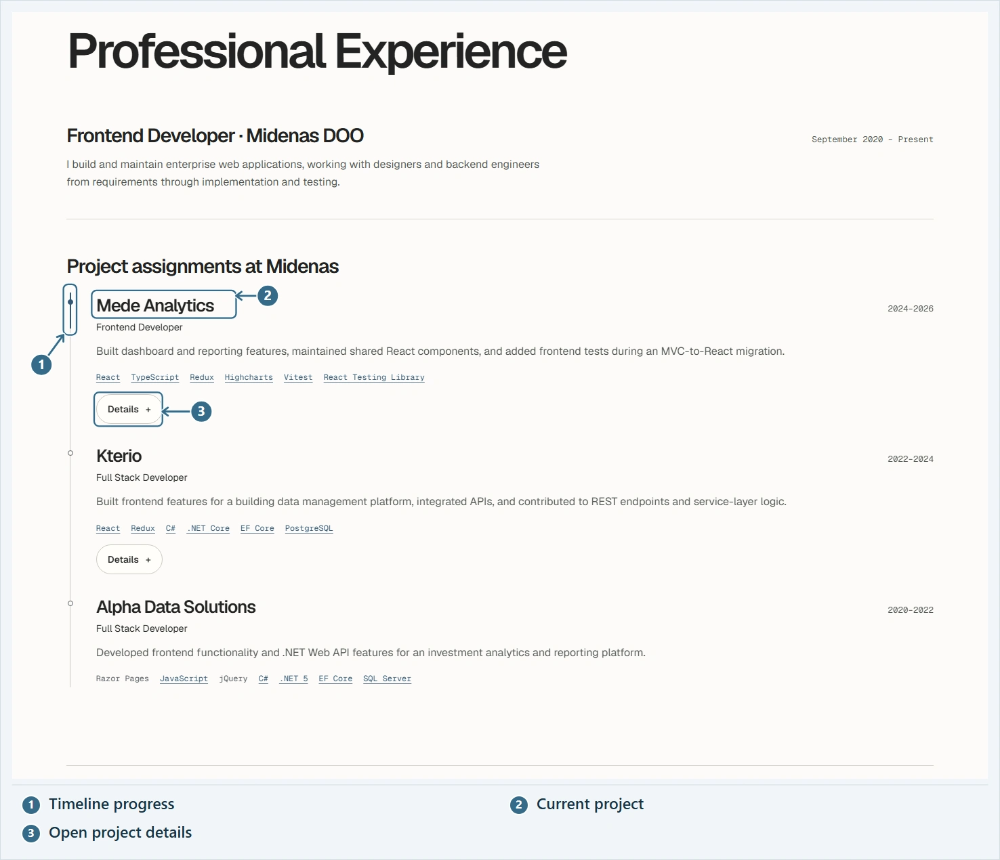
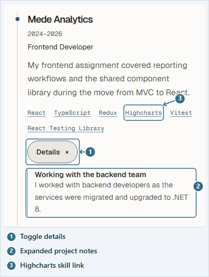

# Explore the engineering examples and project history

[Back to the portfolio walkthrough](../../README.md)

## Technical Skills

1. Open **Skills** from the header. **Frontend Engineering** is the featured category. The other categories cover analytics, testing, APIs and data, and delivery.
2. Choose **Frontend Engineering**, then **React** (1). Hovering over or focusing a technology highlights related technologies. Selecting it opens the skill detail (2), which explains the tool and where it was used.
3. Choose **TypeScript** under **Works with** (3) to replace the React detail with the TypeScript detail. React, TypeScript, and Highcharts link to the Mede Analytics project. C# links to the Kterio experience entry. Use **Close details** to return focus to the technology, or **All categories** to return to the overview.

## How I Engineer

Open **Expertise** from the header to find five engineering areas. Choose an area, then select a concept tab for a specific task. For example, **Maintainable change** starts at the repository snippet and **Regression prevention** starts with the test and both quantity rules visible. Use the left and right arrow keys to switch focused tabs. **All areas** returns focus to the selected area in the index.

### Run the quantity checks

1. Open **Testing & Quality** (1). The **Component tests** tab opens with the implementation visible and the quantity set to 2.
2. Choose **Tests** to read the example test. Select **Run checks** (2) to evaluate the quantity rule in the browser. Both checks pass (3).

1. Check **Remove the quantity limit**.
2. Select **Run checks** again.
3. Read **Expected 3 · Actual 4** under the failing check. The check for adding one item below the limit still passes.
4. Open **Compare both rules** to see both calculations for the same input.

### Try the other areas

| Area | What to try |
| --- | --- |
| Frontend Engineering | In **Component architecture**, pick a part such as **FilterBar** to read its responsibility. In **State management**, choose **Open** to filter the list and its counts. |
| Data Visualization | Hover over, focus, or select a week to read its value and change. Select **3 weeks** to show the most recent three sample weeks and recalculate the average. |
| API Integration | Choose **Simulate error**, wait for **Request failed**, then choose **Simulate success** to see the successful response. Select **Reset** while a simulated request is in progress to return to **Ready to send**. |
| Application Architecture | With **Separate modules** selected, choose **View**, **Service**, or **Repository** to read each module. Select **One module** to see the combined code. |

Under **Frontend Engineering**, try **Narrow** and **Wide** in **Responsive interfaces**. On a wide screen the examples switch between stacked and side-by-side panels. In **Accessibility**, open **Filter options**, press **Tab** to reach **Include completed items**, and press **Space** to toggle it. In **Performance**, use **Next page** and **Previous page** to page through four rows at a time, or choose **All rows** to see all 16.

## Professional Experience

1. Open **Experience** and scroll through the three assignments. With motion enabled, the rail fill (1) follows the scroll position. The dot beside the project near the middle of the viewport fills in (2) in both scroll directions. With reduced motion, the rail is static and the current project still updates.
2. Select **Details** (3) on Mede Analytics or Kterio to expand its project notes. Select **Details** again to collapse them. Alpha Data Solutions shows its summary and tools in the timeline entry.

3. On Mede Analytics, **Details** (1) reveals the .NET 8 migration collaboration note (2). Kterio's details describe the work with Entity Framework Core and PostgreSQL. Select the underlined **Highcharts** link (3) to open and focus that technology in Skills. The browser's **Back** button returns to the originating technology link.

## Education and contact

**Education** jumps to the certification and course list. Continue to **Contact** for **Email**, **LinkedIn**, **GitHub**, and **Download CV**. Email uses your configured mail handler. LinkedIn and GitHub open in new tabs. **Download CV** saves the English DOCX. Use **Back to top** in the footer to return to the Hero.

On mobile, tap **Menu** to reveal the section links. Choosing a section closes the menu and takes you to that section. The theme and EN/SR switches are accessible in the header.
