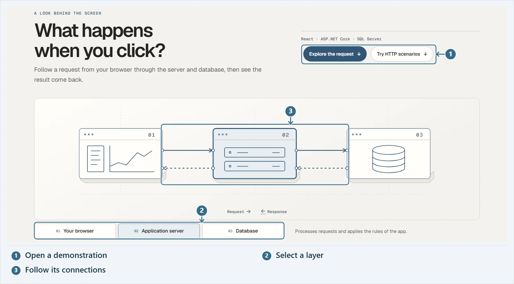
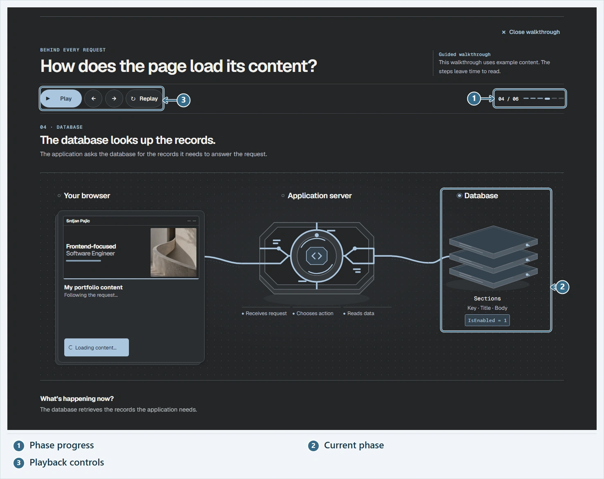
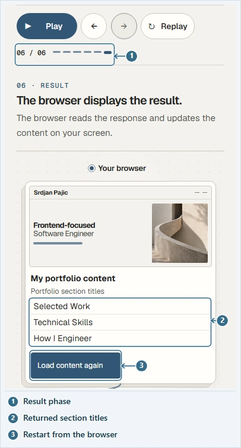
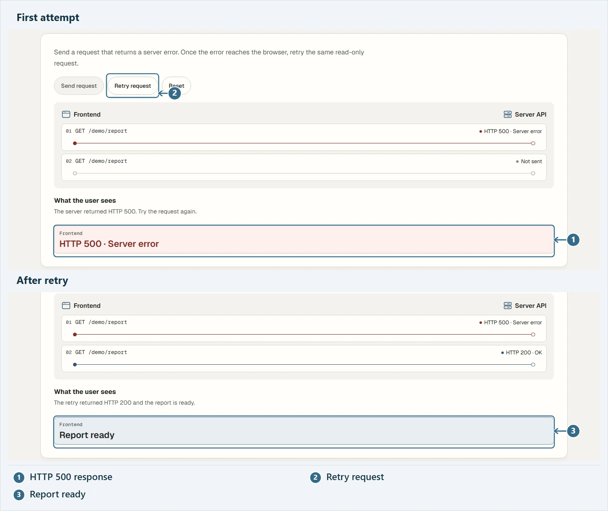

# Behind every request

[Back to the portfolio walkthrough](../../README.md)

Scroll past the Hero to **What happens when you click?**. Start with the architecture diagram, follow a request through six stages, or try a simulated HTTP failure and recovery.

## Explore the architecture

1. **Open an interactive example.** Choose **Explore the request** to open the walkthrough introduction, or **Try HTTP scenarios** to open the simulator.
2. **Select a layer.** Choose **Your browser**, **Application server**, or **Database** to highlight it and read its role. Select the same layer again to close the detail.
3. **Follow the connections.** The solid route carries the request from the browser through the application server to the database. The dashed route carries the result back. In the animated desktop layout, scrolling separates the layers and reveals the connections. Scrolling back stacks the layers again. The compact layout keeps them connected in a static diagram.

## Follow one request

1. From the diagram on the public portfolio, select **Explore the request**, then **Open walkthrough**. The player opens at **01 · Interaction** and uses example content.
2. Select **Play** or **Load content** inside the illustrated browser to start. Select **Pause** whenever you want to read a stage.
3. Use the right arrow (**Next step**) or the left arrow (**Previous step**) to inspect one stage at a time. Either control pauses playback on the selected stage.

1. **Progress.** The indicator reads **04 / 06** while the walkthrough is at the database.
2. **Current stage.** The illustration highlights the database and the explanation describes which part of the system is working.
3. **Playback.** **Play** resumes the sequence. **Replay** starts it again from stage 01.

| Stage | What happens |
| --- | --- |
| 01. Interaction | The simulated browser registers the click and prepares a request. |
| 02. Communication | The browser sends the request to the application server. |
| 03. Processing | The server decides which information to retrieve. |
| 04. Database | The database looks up the records the server needs. |
| 05. Response | The server packages the records for the browser. |
| 06. Result | The browser displays the example section titles **Selected Work**, **Technical Skills**, and **How I Engineer**. |

1. Advance to **06 / 06** to see the result.
2. The illustrated browser displays the three section titles from the example response.
3. Select **Load content again** to restart the sequence.

**Close walkthrough** returns you to the architecture diagram and puts focus back on **Explore the request**.

## Recover from an HTTP error

Choose **Try HTTP scenarios**, select **Recover from HTTP 500**, then select **Send request**. The simulator shows each request between the frontend and server API and displays the resulting browser state.

1. **First attempt.** The first request returns **HTTP 500 · Server error**, and the browser prompts you to try again.
2. **Action.** Select **Retry request** to send the same read-only request again.
3. **After retry.** The second request returns **HTTP 200 · OK** and **Report ready** appears. The first request stays visible as a failed attempt.

Try the other two scenarios to see how the browser handles multiple requests.

- **Responses out of order.** Select **Send request**, then **Send newer request**. The 30-day response arrives first. When the slower 7-day response arrives, only **Without a response check** switches to the older result. **With a response check** shows the current 30-day selection.
- **Cancel a slow request.** Select **Send request** and use **Cancel request** to stop waiting for it, or select **Send replacement** while it is running. Once the replacement finishes, only its result appears in the browser.

Open **How it works in a real app** below the simulator to read the implementation note for the selected scenario. Use **Reset** to run the scenario again or **Close HTTP scenarios** to return to the diagram. The simulator uses example content in both deployments.

With a local HTTPS frontend connected to the backend, **Load content** in the guided walkthrough requests the published section rows from `GET /api/sections`. [Local backend setup](../backend.md#local-setup)
