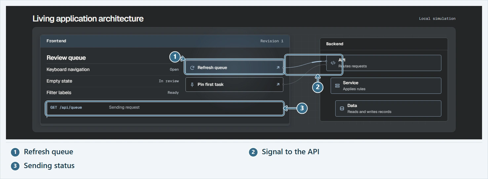
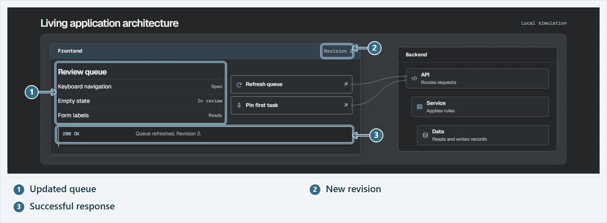
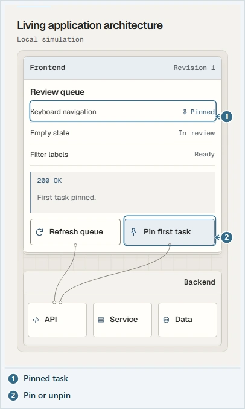
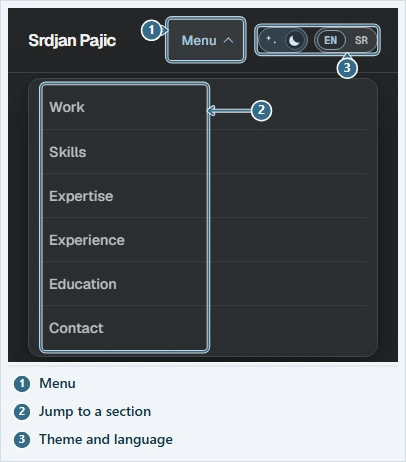

# Opening screen and navigation

[Back to the portfolio walkthrough](../../README.md#opening-screen-and-navigation)

## Refresh the review queue

On a fresh load, **Frontend** shows **Revision 1**. In the desktop layout, hover over **Refresh queue** to preview its connection. Keyboard focus also highlights the related part of the simulation.

1. Select **Refresh queue**.
2. Follow the highlighted signal from the button to **API**.
3. The status shows the simulated **GET /api/queue**. The browser demo traces it through the API, service, and data layers using local state.

1. When the response returns, the third task changes from **Filter labels** to **Form labels**.
2. The revision advances to **Revision 2**.
3. Move the pointer away from the simulation controls to see the completed **200 OK** status. Selecting **API**, **Service**, or **Data** in the backend column lets you inspect a particular layer.

## Pin a task on a phone

1. Tap **Pin first task**. The first task changes to **Pinned** and the status confirms the change.
2. Tap the same button again to unpin it.

## Jump to a section

1. Tap **Menu** to expand the navigation.
2. Choose a section such as **Skills**. The menu closes and the page goes to that section.
3. Use the theme switch or **EN / SR** from the header. You can change them while exploring the page. The choice is kept on the next visit.
