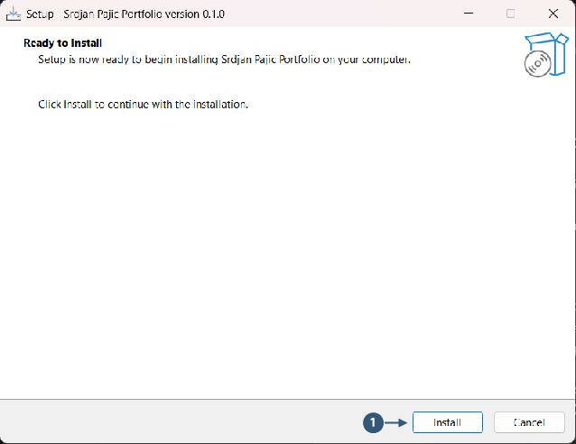
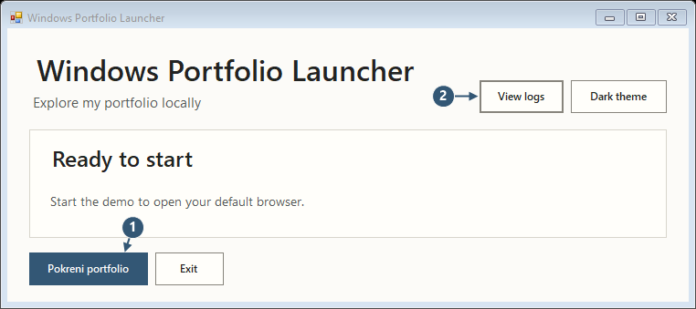
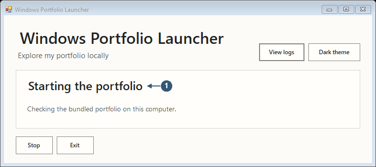
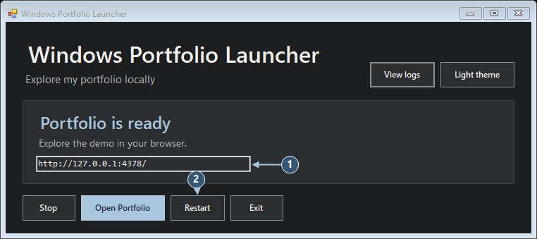
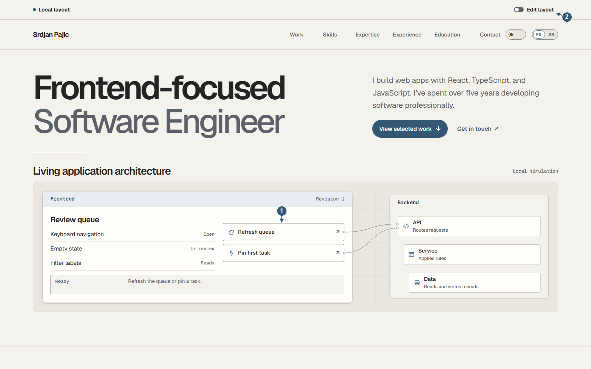
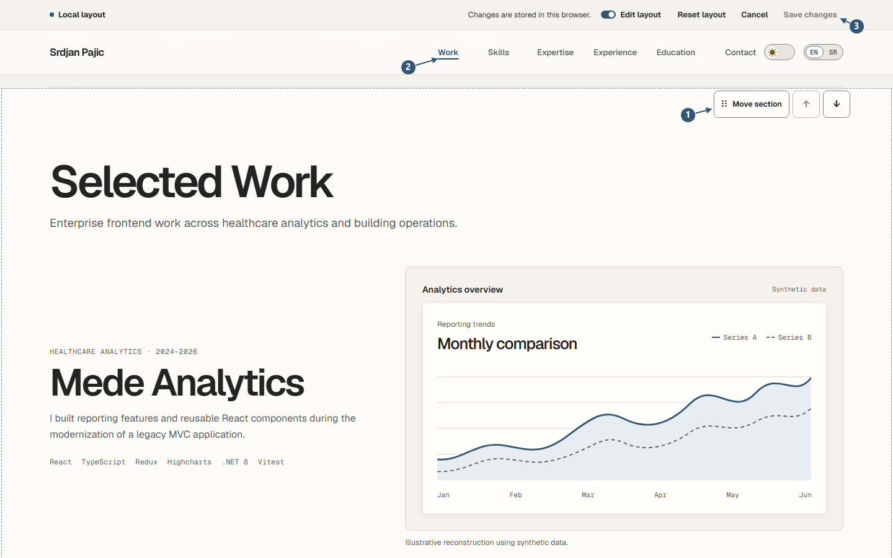
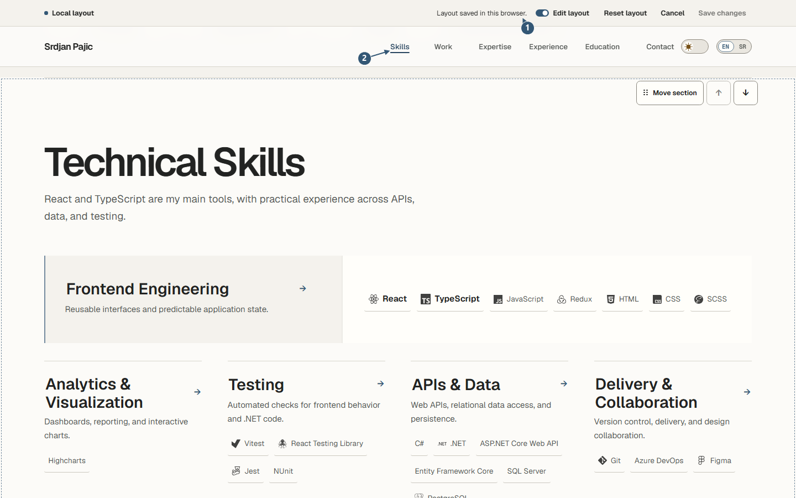
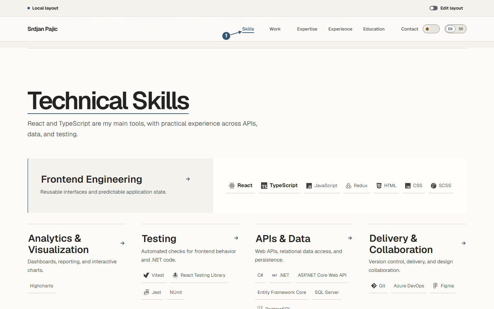
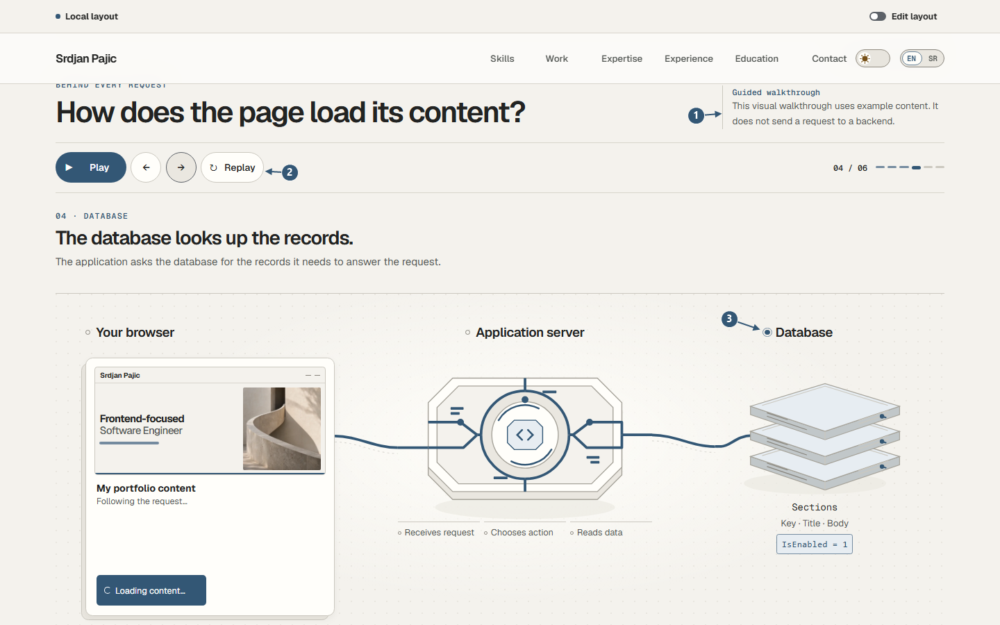
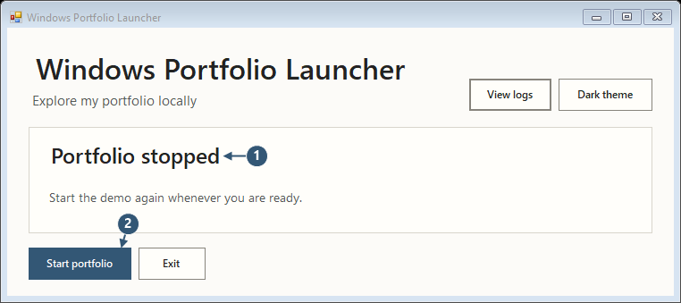

# Windows One-Click Launcher

[Back to the portfolio walkthrough](../../README.md#windows-one-click-launcher) · [Open the public portfolio](https://srdjan7991-sudo.github.io/portfolio/)

## Download and install

1. Select **Preuzmi portfolio za Windows** in the README to download one installer from the latest published release. [Portfolio-Setup.exe](https://github.com/srdjan7991-sudo/portfolio/releases/latest/download/Portfolio-Setup.exe)
2. Open **Portfolio-Setup.exe**. Proceed to **Ready to Install** and select **Install**. Setup copies the bundled frontend to your user profile and adds **Portfolio Launcher** shortcuts to the desktop and Start menu.
3. If the final page offers **Pokreni Portfolio Launcher**, check it before selecting **Finish** to open the launcher immediately. Leave it unchecked to open the launcher later from either shortcut.



## Open the portfolio



1. **Pokreni portfolio** starts the local browser demo. The launcher checks that the bundled page responds before opening the default browser.
2. **View logs** shows the launcher’s latest events and errors.



1. **Starting the portfolio** means the local availability check is in progress.



1. **Portfolio is ready** displays the actual local address. If the usual port is busy, the launcher displays the alternate address. Use **Open Portfolio** to reopen the page in the default browser. If Windows blocks the handoff, copy the displayed address into a browser.
2. **Restart** runs the availability check again. Refresh the browser tab if it was already open.



1. Start with **Refresh queue** or **Pin first task** in the Hero simulation.
2. **Edit layout** is available without signing in. Use the usual navigation, language and theme controls to explore the portfolio.

The installer includes the same production React views as the public portfolio. It works offline on Windows 10 or 11 with a current browser. Authenticated actions and server-side saving are available through the separate [API development setup](../backend.md#local-setup).

## Edit and save the section order



1. Turn on **Edit layout**. Use the up and down buttons or drag **Move section**. With the keyboard, press Space or Enter on the handle, move with the arrow keys, then press Space or Enter again to drop it. Escape cancels the current move.
2. The order and the header links update immediately. For example, move **Selected Work** down once to place **Technical Skills** ahead of it. The Hero, request walkthrough and Footer keep their positions.
3. **Save changes** keeps your order. **Cancel** exits editing and restores the last saved order. **Reset layout** previews the original order. Select **Save changes** to keep that reset.



1. **Layout saved in this browser** confirms a local write.
2. The header reflects the new order. Its links still go to the corresponding sections.



1. Refresh or reopen the same local address in the same browser profile. The saved order returns with editing off.
2. The launcher remembers its last port. If that port becomes unavailable, the new local address has separate browser storage. Layout, theme and language are scoped to the browser profile and local address.

## Follow a request offline

Select **Explore the request**, then **Open walkthrough** below the Hero.



1. The guided notice explains that the walkthrough animates example content without sending a backend request.
2. Use **Play**, **Pause**, the step arrows, or **Replay** to explore all six stages.
3. Follow the browser, server and database connections. The diagram stays interactive offline, as do the separate HTTP scenarios and synthetic Analytics Report. [Full request walkthrough](request-flow.md)

## Stop or diagnose the launcher

1. Select **Stop** to stop the local server and keep the launcher open. **Exit** or closing its window also stops the server.
2. **Portfolio stopped** means the local server has shut down. Start again with **Pokreni portfolio**. Browser-local settings stay available at the same address.



Use **View logs** if startup fails. Select an event to read or copy its details. Logs are under `%LOCALAPPDATA%\PortfolioLauncher`. If launcher files are missing, run **Portfolio-Setup.exe** again.

To uninstall, close the launcher. Open **Settings → Apps → Installed Apps**, select **Srdjan Pajic Portfolio**, and choose **Uninstall**. The uninstaller removes the installed files and both shortcuts. The browser manages the layout, theme and language saved at the local address.

## Download trust and signing

Microsoft Edge displayed an uncommon-download warning for the public `v0.1.0` EXE. Microsoft Defender SmartScreen uses file and publisher reputation for this check. The downloaded EXE matched the SHA-256 digest of the tested GitHub Release asset, and Windows reported `NotSigned` for its Authenticode status. The publisher name displayed in Setup comes from installer metadata. [Microsoft Edge SmartScreen documentation](https://learn.microsoft.com/en-us/deployedge/microsoft-edge-security-smartscreen)

Download from GitHub Releases and compare the local SHA-256 with the digest for that exact asset. Keep one tested `Portfolio-Setup.exe` per versioned release and publish the digest of the final installer bytes. To verify the first release, use the [v0.1.0 release asset metadata](https://api.github.com/repos/srdjan7991-sudo/portfolio/releases/assets/787568677).

```powershell
Get-FileHash -Algorithm SHA256 -LiteralPath .\Portfolio-Setup.exe
Get-AuthenticodeSignature -LiteralPath .\Portfolio-Setup.exe
```

For future releases, use a publicly trusted, timestamped Authenticode signature under a consistent verified publisher identity. An Individual Validation (IV) code-signing certificate is an option for a personal portfolio. Check eligibility for the applicant's country before buying. SSL.com lists a one-year IV certificate at US$129, with entry-level cloud key storage at US$15 per month or a physical token priced separately. Azure Artifact Signing Public Trust for individuals requires U.S. or Canadian residency. SmartScreen reputation still builds over time, so signing can leave an initial warning on a new build. [IV pricing](https://www.ssl.com/products/software-integrity/code-signing/iv/) · [Cloud signing pricing](https://www.ssl.com/products/software-integrity/signing-service/) · [Azure eligibility](https://learn.microsoft.com/en-us/azure/artifact-signing/quickstart#prerequisites) · [Windows signing and reputation](https://learn.microsoft.com/en-us/windows/apps/package-and-deploy/smartscreen-reputation)

## Build the installer from source

Use Node.js 24, Windows PowerShell 5.1, and Inno Setup 6.7.4 for packaging. Run these commands from the repository root with the path to your Inno Setup compiler.

```powershell
npm ci
powershell.exe -NoProfile -ExecutionPolicy Bypass -File launcher/Build-WindowsInstaller.ps1 -CompilerPath C:/tools/Inno/ISCC.exe -Version 0.1.0
```

The builder writes `artifacts/Portfolio-Setup.exe`. The installer contains the launcher and finished Vite bundle. Windows PowerShell 5.1 runs the server on IPv4 loopback inside the launcher process. [Installer checks and release workflow](../testing-and-deployment.md#windows-demo-checks)
